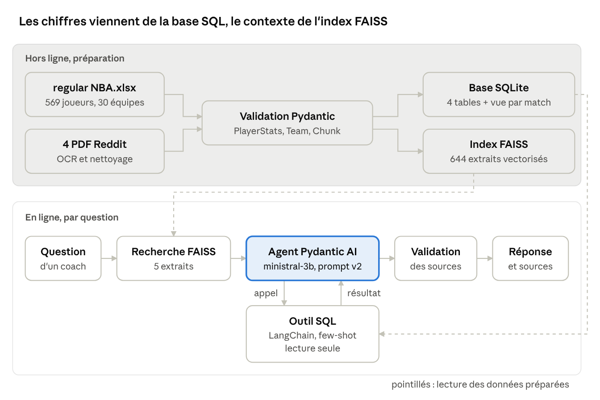
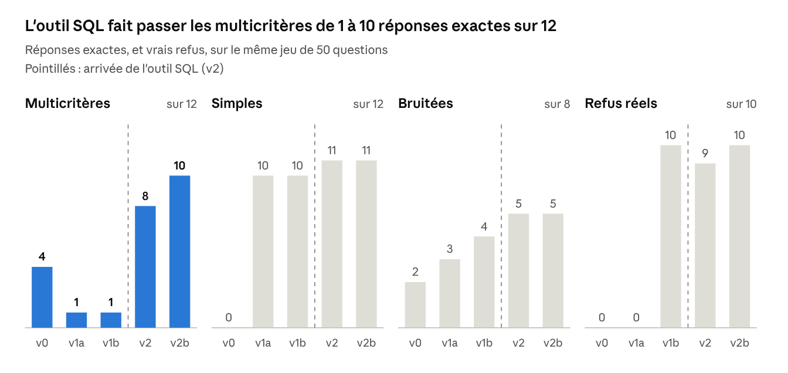

# Projet 10 — Rapport d'évaluation de l'assistant RAG SportSee

13 octobre 2026

## 1. Introduction et contexte

En quatre versions mesurées, l'assistant est passé de 0 à 11 questions simples exactes sur 12, de 1 à 10 questions multicritères exactes sur 12, et de 0 à 10 refus corrects sur 10 questions sans réponse possible.

**Le besoin.** SportSee veut un assistant qui réponde aux coachs et analystes sur la saison régulière NBA 2024-25. Il s'appuie sur deux sources : un fichier Excel de statistiques (569 joueurs, totaux de saison) et quatre PDF de discussions Reddit.

**Le problème de départ.** Un prototype RAG existait (Mistral, index FAISS, interface Streamlit), mais personne ne savait s'il était fiable. Les coachs signalaient des réponses fausses sur les chiffres, sans moyen de mesurer l'ampleur du problème.

**L'objectif.** Évaluer le système de façon mesurable et reproductible, l'améliorer, puis prouver l'amélioration sur le même jeu de test.

**La démarche, en trois étapes :**

1. **Évaluation de référence et préparation des données** : un jeu de 50 questions métier, un script d'évaluation RAGAS, un pipeline de données validé par Pydantic, un agent Pydantic AI et un suivi Logfire.
2. **Base SQL et outil d'interrogation** : une base SQLite chargée par un script validé par Pydantic, et un outil SQL (LangChain, exemples few-shot) branché sur l'agent.
3. **Réévaluation et analyse critique** : comparaison des versions, mesure du bruit de l'évaluation, limites et recommandations.

Chaque version ne change qu'une famille de variables à la fois. Le générateur (`ministral-3b-2512`), le juge (`ministral-14b`), le jeu de test et l'index vectoriel restent identiques d'une version à l'autre, sauf quand l'index est lui-même l'objet du changement.

## 2. Architecture du système

Le système final (v2b) combine deux sources : une base SQLite pour les chiffres et un index vectoriel FAISS pour le contexte et les discussions, interrogés par un agent dont la réponse est validée avant d'être rendue.

Hors ligne, les données sont validées puis chargées dans la base et dans l'index. En ligne, la recherche FAISS est toujours faite ; l'agent appelle l'outil SQL quand la question est chiffrée (au plus deux fois), puis sa réponse passe par le validateur de sources.

### 2.1 Choix techniques

| Élément | Choix | Raison |
| --- | --- | --- |
| Générateur | `ministral-3b-2512` | Accessible avec l'abonnement (`mistral-small` limité par les erreurs 429) ; constant dans toutes les versions |
| Juge RAGAS | `ministral-14b` | `mistral-large` refusé (erreur 403), `small` et `medium` limités (429) |
| Embeddings | `mistral-embed` (1 024 dimensions) | Cohérent avec le générateur |
| Index | FAISS, similarité cosinus | Exact, sans serveur, suffisant pour 644 extraits |
| Base | SQLite | Un fichier, rien à installer, reproductible |
| Agent | Pydantic AI | Sortie typée (`ReponseAssistant`), validation et relances intégrées, outils |
| Outil SQL | LangChain, 9 exemples few-shot | Demandé par l'énoncé ; un petit modèle imite mieux qu'il n'applique des règles |
| Recherche vectorielle | Conservée systématique | Ne changer qu'une variable par rapport à la v1 |

### 2.2 Les garde-fous de l'outil SQL

La requête étant écrite par un LLM, deux protections indépendantes s'appliquent : une connexion SQLite en **lecture seule**, et un contrôle applicatif qui n'accepte qu'une instruction `SELECT` (ou `WITH`) sans mot-clé d'écriture. Les erreurs SQL sont renvoyées au modèle, qui dispose d'une tentative de correction.

### 2.3 Observabilité

Logfire trace chaque question : recherche (sources et scores), construction du prompt, appels du modèle, appels de l'outil SQL avec leurs requêtes et leurs tentatives, puis le bilan de la réponse (sources citées, information disponible, nombre de requêtes). C'est ce suivi qui a permis de diagnostiquer les échecs de la v2.

## 3. Qualité des données

Les 569 joueurs passent la validation sans rejet, mais l'Excel contient des anomalies cachées : 31 noms abîmés, 206 totaux de rebonds incohérents, des pourcentages qui ne correspondent pas aux tirs réussis et tentés, et un dictionnaire des données faux sur les unités.

### 3.1 Validation par Pydantic

Chaque ligne passe par un modèle Pydantic avant d'être indexée ou insérée en base :

- **`PlayerStats`** (45 colonnes) : types et bornes (`ge`, `le`), alias vers les noms de l'Excel, nettoyage du nom avant validation, contrôle de l'équipe par un contexte de validation (la liste des codes de la feuille « Equipe »).
- **`Team`** : code de trois majuscules, nom complet.
- **`Chunk`** et **`EmbeddedChunk`** : longueur des extraits, dimension (1 024) et non-nullité des vecteurs.
- **`ReponseAssistant`** : la sortie de l'agent, avec un validateur de cohérence (sources citées présentes dans le contexte, pas de source sur un refus, pas d'affirmation sans source).

Les règles sont de deux niveaux. Les règles **bloquantes** rejettent une ligne impossible (`W + L ≠ GP`, plus de tirs réussis que tentés, plus de triple-doubles que de double-doubles). Les règles **non bloquantes** signalent un écart sans rejeter la ligne, dans un champ `anomalies` exclu de la base.

### 3.2 Anomalies trouvées et décisions

Le principe retenu : **corriger ce qui est certain, signaler ce qui ne l'est pas, ne jamais modifier le fichier source.** Les corrections vivent dans le code, donc elles sont tracées, versionnées et rejouées à chaque chargement.

| Anomalie | Lignes | Traitement | Justification |
| --- | --- | --- | --- |
| Noms avec virgules (`Jaren Jackson Jr,`, `P,J, Washington`) | 31 | Corrigé (virgule → point) | Aucun nom NBA ne contient de virgule : correction certaine |
| `REB ≠ OREB + DREB` (écarts de −8 à +8) | 206 | Conservé et signalé | On ignore quelle valeur est fausse ; le jeu de test utilise la colonne REB |
| FG%, 3P%, FT% différents de réussis / tentés | environ 1 250 | Signalé | Même raisonnement ; les références du jeu de test viennent de ces colonnes |
| EFG% et TS% supérieurs à 100 | quelques-unes | Accepté (borne à 150) | Mathématiquement possible sur très peu de tirs |
| Colonne 3PM lue par Excel comme l'heure 15:00:00 | 1 colonne | Renommée (repérée par son type) | Erreur de conversion d'Excel |
| Dictionnaire : PTS, FGM… décrits « par match » | — | Unités réécrites pour le LLM | Ce sont des totaux (SGA : 2 485 points) |
| Aucune donnée par match | — | Table `matches` créée vide | Rien n'est inventé ; le schéma reste extensible |

Toutes les anomalies sont consignées dans `docs/audit/anomalies_donnees.csv` (joueur, règle, détail, traitement appliqué).

### 3.3 La base SQL

La base SQLite (`data/nba.db`) compte quatre tables et une vue :

- **`teams`** (30 lignes) et **`players`** (569 lignes), reliées par une clé étrangère sur le code d'équipe ;
- **`player_stats`** (569 lignes, une par joueur pour toute la saison), dont les colonnes sont générées à partir du modèle Pydantic : le modèle et la table ne peuvent pas diverger ;
- **`matches`**, vide : l'énoncé la prévoit, mais les données fournies sont agrégées par saison ;
- la vue **`player_per_game`**, qui calcule les moyennes par match (`ROUND(total * 1.0 / gp, 1)`). C'est la base, et non plus le LLM, qui divise.

SQLite a été préféré à PostgreSQL pour la reproductibilité : un fichier, rien à installer. Ses pièges ont été traités explicitement : clés étrangères activées à chaque connexion, typage contrôlé en amont par Pydantic, fonction `sans_accents` pour compenser l'absence d'`ILIKE`.

## 4. Méthodologie d'évaluation

L'évaluation combine RAGAS, une métrique d'exactitude déterministe et une vérification manuelle des refus, car RAGAS seul ne distinguait pas une réponse juste d'une réponse fausse sur un chiffre.

### 4.1 Le jeu de test

50 questions réparties en six catégories, figées dans `eval/testset.json` :

| Catégorie | Questions | Ce qu'elle teste | Exemple |
| --- | --- | --- | --- |
| Simple | 12 | Une valeur d'un joueur | 3P% de Devin Booker |
| Multicritères | 12 | Classement, filtre, comparaison sur 569 joueurs | Meilleur marqueur de la saison |
| Bruitée | 8 | Variantes avec fautes ou formulation familière | B02, variante de S07 (points par match de Herro) |
| Textuelle | 8 | Contenu des discussions Reddit | Joueur qui approche l'efficacité de Reggie Miller |
| Hors données | 6 | Information absente des sources | Points de SGA en playoffs |
| Hors sujet | 4 | Question sans rapport avec la NBA | Vainqueur de Roland-Garros |

Les références chiffrées sont calculées avec pandas à partir de l'Excel, jamais écrites à la main.

### 4.2 Les métriques

**RAGAS** (version 0.4.3), avec `ministral-14b` comme juge : `faithfulness` (la réponse est-elle fondée sur le contexte ?), `answer_relevancy` (répond-elle à la question ?), `context_precision` et `context_recall` (le retriever trouve-t-il les bons extraits ?), `answer_correctness` (proximité avec la référence).

**Les métriques complémentaires**, ajoutées parce que RAGAS s'est révélé insuffisant :

- **Exactitude déterministe** (`utils/exactitude.py`) : la réponse contient-elle les éléments attendus (nombres à 0,05 près, noms sans accents ni casse) ? Elle a été créée après avoir constaté qu'`answer_correctness` notait 0,75 une réponse fausse (9,8 au lieu de 8,5).
- **Taux de refus** sur les 10 questions sans réponse possible, déclaré par l'agent puis **vérifié à la main** : un refus déclaré peut contenir un chiffre inventé.
- **Réponses en erreur** : pannes techniques ou validations échouées.
- **Origine des réponses** (`origine_reponses.py`) : un élément juste vient-il du contexte ou des connaissances du modèle ?

### 4.3 Les seuils

Deux niveaux par métrique et par catégorie : un seuil **bêta** (utilisable sous surveillance) et un seuil **cible** (production). Par exemple, pour les questions simples : faithfulness 0,80 / 0,85 et exactitude 0,80 / 0,90. Ces seuils ont été fixés après l'observation de la v0 et de la v1, avant la v2. Ils ne sont donc pas totalement indépendants des résultats.

### 4.4 La rigueur du protocole

- **Une famille de variables à la fois** : données (v1a), génération (v1b), validation (v1c), outil SQL (v2), correctifs (v2b).
- **Constantes** : même jeu de test, même juge, même générateur, même index vectoriel depuis la v1a.
- **Mesure du bruit** : la v0 a été évaluée deux fois, ce qui donne l'écart obtenu par le seul hasard (section 6).
- **Comparaison à questions égales** : `comparer_versions.py` ne compare deux versions que sur les questions notées dans les deux.
- **Traçabilité** : chaque évaluation enregistre ses réponses, ses contextes, ses requêtes SQL et la description du pipeline (`config.json`), et chaque version porte un tag Git.

## 5. Résultats

La v2b est la meilleure version sur l'exactitude et la fiabilité : 11 questions simples exactes sur 12, 10 multicritères sur 12, 10 vrais refus sur 10 et aucune erreur technique. Sur RAGAS, elle est équivalente à la v2 (section 6).

Chaque version corrige un type d'erreur différent :

| Version | Changement | Ce qu'elle a corrigé | Ce qui restait |
| --- | --- | --- | --- |
| v0 | Prototype d'origine | — | Excel aplati et découpé : la fiche de Harden était classée 91e sur 302 extraits. Les 4 multicritères exactes l'étaient par la célébrité des joueurs, pas par le contexte |
| v1a | Données restructurées (une fiche par joueur, 45 colonnes nommées) | L'accès aux données : la fiche de Harden passe 1re sur 644 | Le bon chiffre est entouré d'inventions ; aucun refus |
| v1b | Prompt pour coachs, agent Pydantic AI, Logfire | La fiabilité : refus, sources citées, réponses sobres | Erreurs de calcul (S07, S10) ; classements impossibles sur 5 fiches |
| v1c | Validateur de cohérence des sources | Les sources inventées (non évaluée isolément) | 3 faux positifs, vus en v2 |
| v2 | Outil SQL (base SQLite, LangChain few-shot) | Le calcul et le classement : multicritères de 1 à 8 sur 12 | 4 mauvais choix d'outil, 3 erreurs techniques, 1 faux refus |
| v2b | Correctifs et règles 13-14 | Le conflit entre documents et base ; les faux positifs | M04, M07 (restitution), bruitées 5 sur 8, textuelles |

En v1b, un des 10 refus contenait un détail inventé (une saison citant 2022-2023). La faithfulness globale progresse de 0,216 (v0) à 0,721 (v1b), puis 0,775 (v2b) ; le détail par version est en annexe A.

**L'agent utilise l'outil à bon escient.** En v2, il l'a appelé pour 10 questions multicritères sur 12, 3 bruitées sur 8 et 1 simple sur 12, jamais pour les questions textuelles ou hors sujet. Lors des tests de la v2b, les règles 13 et 14 l'ont aussi fait appeler pour une moyenne par match (S07 : 23,9 points, la valeur exacte, au lieu de 23,8 calculé par le modèle en v2).

**Les seuils fixés sont atteints pour les questions chiffrées**, pas pour les autres. Questions simples : niveau cible en exactitude (0,917) et en faithfulness (0,903). Multicritères : cible en exactitude (0,944) et en faithfulness (0,860). Bruitées : bêta en faithfulness (0,812), non atteint en exactitude (0,625). Textuelles : non atteints (faithfulness 0,689, answer\_correctness 0,384).

## 6. Analyse critique

Les gains de la v2 viennent de l'outil SQL, mais ses échecs viennent surtout du conflit entre deux sources, et RAGAS ne permet pas de départager des versions proches : son bruit dépasse les écarts à mesurer.

### 6.1 Les échecs de la v2 et leur cause commune

Chaque échec de la v2 a été classé en relisant la réponse et la requête SQL exécutée :

| Cause | Questions | Exemple |
| --- | --- | --- |
| Mauvais choix d'outil (pas d'appel SQL) | S07, M02, M12, B07 | « Le meilleur marqueur est P.J. Washington, 838 points » : le meilleur des 5 fiches récupérées |
| Mauvaise restitution | M04, M07 | M07 : la requête renvoie les 6 bons joueurs, l'agent les écarte car « absents du contexte fourni » |
| Requête fausse | B06 | Tri sur les tirs tentés au lieu du pourcentage de réussite |
| Question bruitée mal comprise | B03 | Répond le nombre de matchs de Gobert au lieu de son équipe |

Le générateur SQL n'est en cause qu'une fois sur huit. La cause principale est l'architecture retenue (la recherche vectorielle reste systématique) : les 5 fiches récupérées donnent à l'agent l'illusion d'avoir toutes les données, et les règles de la v1 (« réponds à partir du contexte fourni ») lui font rejeter les résultats SQL. Les règles 13 et 14 de la v2b (« les documents ne sont qu'un extrait », « les résultats SQL sont un contexte valide ») ont corrigé M02 et M12. **Ajouter un outil ne suffit pas : le prompt doit réconcilier les deux sources.**

### 6.2 Les limites des métriques

**Le bruit de l'évaluation est mesuré.** Entre deux exécutions du même pipeline v0, les moyennes par catégorie varient jusqu'à ±0,05 (answer\_correctness), ±0,07 (faithfulness) et ±0,12 (answer\_relevancy). Par question, l'écart atteint 0,51. Deux réponses identiques à un mot près (T01, « Orange Magic » contre « Orlando Magic ») obtiennent 0,55 puis 0,21. Entre v2 et v2b, deux réponses identiques mot pour mot (B05) passent de 1,0 à 0,5 en faithfulness. Sur 8 à 12 questions par catégorie, ce bruit masque des gains réels : en multicritères, deux réponses corrigées sur douze ne font gagner que 0,047 d'answer\_correctness, soit le niveau du bruit.

**Les moyennes ne se comparent que sur les mêmes questions.** En moyenne globale, la v2 semble meilleure que la v2b (faithfulness 0,822 contre 0,775). Mais la v2 n'a pas été notée sur ses 3 questions en erreur, et la moyenne inclut les catégories de refus. Sur les 37 questions à réponse notées dans les deux versions, les écarts globaux tombent sous 0,02 (sauf answer\_relevancy).

**Chaque métrique a un angle mort :**

- **faithfulness** mesure la fidélité au contexte, pas la justesse. En v2, B07 (« James Harden a marqué le plus de points », faux) obtient 1,0 parce que sa fiche figure dans les extraits ; le refus honnête de la v2b obtient 0.
- **answer\_relevancy** vaut 0 sur un refus par conception, mais aussi sur des réponses justes : M06, M11 et M12 en v2b, M08 en v2, et des réponses de la v0. Le faux refus H01 de la v2, qui donnait un chiffre, a même relevé le score de sa catégorie.
- **answer\_correctness** a un plancher d'environ 0,2 et ne distingue pas 9,8 de 8,5.
- **context\_precision** ne voit pas la voie SQL : 0,181 en multicritères, parce qu'elle juge les fiches FAISS alors que la réponse vient de la base.
- **Aucune métrique** ne détecte une requête SQL fausse dont le résultat est fidèlement restitué (B06 : faithfulness 1,0).

### 6.3 Les limites de la validation par les sources

Le validateur de `ReponseAssistant` garantit que les chiffres **viennent** des données, pas qu'ils **répondent** à la question. En v2, à la question « meilleur 3P% sur les 5 derniers matchs » (H01), l'agent a déclaré l'information non disponible tout en donnant un joueur et un pourcentage (« Vít Krejčí, 43,7 % ») : sans source citée, la réponse était cohérente aux yeux du validateur. Lors des premiers tests, la même question avait déjà produit des pourcentages de saison présentés comme récents, avec la source SQL légitimement citée. À l'inverse, il a rattrapé la même hallucination en v2b (refus déclaré citant une source, donc rejeté puis reformulé en vrai refus). Trop strict sur la forme, il a aussi produit 3 faux positifs en v2 : le modèle citait « Reddit 2.pdf (Score: 77.1%) » au lieu de « Reddit 2.pdf ». La v2b normalise les sources avant de les comparer.

### 6.4 Les limites d'un petit modèle

`ministral-3b` (3 milliards de paramètres) a imposé plusieurs contournements :

- **Il imite les exemples plus qu'il n'applique les règles** : la règle « ajouter un seuil de volume aux classements en pourcentage » a été ignorée (Sam Hauser, 100 % sur 14 lancers francs) jusqu'à l'ajout d'un exemple few-shot (Jrue Holiday, 90,9 % sur 74).
- **Il ne tient pas compte des messages d'erreur** : la seconde tentative SQL reprend parfois la première à l'identique, et le modèle a répété trois fois la même source mal formatée malgré le message du validateur.
- **Il est sensible au prompt** : un seul exemple ajouté a modifié des requêtes sans rapport avec lui. Toute modification impose de réévaluer l'ensemble du jeu.

### 6.5 Les limites du protocole

- **Une seule exécution par version** (sauf la v0) : les écarts inférieurs au bruit mesuré ne sont pas interprétés.
- **La v1c n'a pas été évaluée isolément** : son effet de bord (les 3 faux positifs) n'a été vu qu'en v2 et corrigé en v2b.
- **50 questions** : 4 à 12 par catégorie, donc une question vaut 8 à 25 points de pourcentage.
- **Seuils fixés après observation** des premières versions.
- **Index vectoriel non reconstruit** pendant l'étape 2 : il contient encore les noms bruts (« Jaren Jackson Jr, »), alors que la base contient les noms corrigés.

## 7. Recommandations

La v2b peut être ouverte en bêta aux coachs pour les questions chiffrées sur la saison, mais pas pour les questions sur les discussions Reddit, qui restent sous les seuils.

### 7.1 À court terme

1. **Imposer l'outil SQL par le code pour les superlatifs.** Un `output_validator` Pydantic AI renvoie l'agent appeler l'outil quand la question contient « le plus », « le meilleur » ou « par match » et qu'aucune requête n'a été faite, sauf pour les questions sur une période. Les règles du prompt ne suffisent pas avec un petit modèle.
2. **Contrôler les refus de façon déterministe.** Un refus ne doit contenir aucun nombre présent dans les résultats SQL de la question. Cette règle aurait bloqué le faux refus H01 de la v2.
3. **Exécuter chaque version au moins trois fois** et ne retenir que les écarts supérieurs au bruit mesuré.
4. **Piloter avec l'exactitude et les refus vérifiés**, et garder RAGAS pour le diagnostic. Retirer `answer_relevancy` et `context_precision` du tableau de bord tant que leurs angles morts ne sont pas corrigés.

### 7.2 Pour les questions textuelles

C'est le principal chantier restant (answer\_correctness 0,384 en v2b, sous le seuil bêta de 0,50). L'étape 2 ne les concernait pas : elles dépendent de la recherche vectorielle seule. Pistes à évaluer une par une : le découpage des PDF Reddit (un fil de discussion par extrait plutôt qu'un découpage par taille), le nombre d'extraits récupérés (au-delà de 5), et une recherche hybride (mots-clés et vecteurs).

### 7.3 Pour la mise en production

- **Un modèle plus grand pour la génération SQL**, qui suivrait mieux les règles et corrigerait réellement ses erreurs.
- **Des données match par match** pour alimenter la table `matches` déjà prévue, ce qui rendrait possibles les questions sur une période.
- **Un suivi continu avec Logfire** : taux de refus, taux d'erreurs, part des requêtes SQL corrigées, part des questions avec appel d'outil.
- **Une API REST** (FastAPI, `POST /ask` et `GET /health`) pour intégrer l'assistant aux outils de SportSee.
- **Une source de données corrigée** : les anomalies signalées dans le journal d'audit sont à remonter au fournisseur des données.

## 8. Conclusion

Chaque version a corrigé un type d'erreur différent. La v1a a corrigé l'accès aux données : le bon chiffre arrive dans le contexte. La v1b a corrigé la fiabilité : l'agent refuse quand l'information manque et cite ses sources. La v2 a corrigé le calcul et le classement : c'est la base SQL qui trie et divise, pas le LLM.

Le principal enseignement porte sur l'évaluation elle-même. Aucune métrique automatique ne suffit seule : RAGAS a noté favorablement une réponse fausse, pénalisé des refus honnêtes et des réponses justes, et son bruit dépasse les écarts entre versions proches. Évaluer un assistant de ce type demande des métriques complémentaires, dont une exactitude déterministe, une comparaison à questions égales, une mesure du bruit et une relecture manuelle des cas limites.

## Annexes

### A. Scores RAGAS par version

Moyennes globales sur les 50 questions (v0 : première exécution). À comparer avec prudence : les ensembles notés diffèrent (3 questions en erreur en v2) et les catégories de refus faussent answer\_relevancy.

| Métrique | v0 | v1a | v1b | v2 | v2b |
| --- | --- | --- | --- | --- | --- |
| faithfulness | 0,216 | 0,459 | 0,721 | 0,822 | 0,775 |
| context\_precision | 0,194 | 0,449 | 0,476 | 0,509 | 0,503 |
| context\_recall | 0,313 | 0,640 | 0,590 | 0,762 | 0,750 |
| answer\_correctness | 0,257 | 0,274 | 0,544 | 0,631 | 0,657 |

Par catégorie à réponse (faithfulness / answer\_correctness) :

| Catégorie | v1b | v2 | v2b |
| --- | --- | --- | --- |
| Simples | 0,842 / 0,789 | 0,875 / 0,851 | 0,903 / 0,797 |
| Bruitées | 0,658 / 0,470 | 1,000 / 0,528 | 0,812 / 0,611 |
| Multicritères | 0,640 / 0,314 | 0,789 / 0,636 | 0,860 / 0,683 |
| Textuelles | 0,710 / 0,422 | 0,760 / 0,374 (5 questions notées) | 0,689 / 0,384 |

### B. Règles ajoutées au prompt de l'agent en v2 et v2b

Le prompt v2 reprend les 6 règles du prompt v1 (orienté coachs, voir `rag_pipeline.py`) et ajoute :

| Règle | Contenu | Problème traité |
| --- | --- | --- |
| 7 | Question chiffrée : appeler l'outil SQL avant de répondre | Faire utiliser l'outil |
| 8 | Les chiffres de l'outil priment ; ne pas les recalculer | Erreurs de calcul |
| 9 | Citer « Base de données NBA (SQL) » | Traçabilité |
| 10 | Aucune ligne ou erreur : information non disponible | Inventions |
| 11 | Données de saison entière ; période précise : non disponible | Chiffres de saison présentés comme récents |
| 12 | Chiffres donnés : information disponible et sources non vides | Drapeau incohérent |
| 13 | Documents = extrait ; superlatif ou moyenne par match : outil obligatoire | Mauvais choix d'outil |
| 14 | Résultats de l'outil = contexte valide | Résultats SQL rejetés |

### C. Exemples few-shot de l'outil SQL

Aucun exemple ne reprend une question du jeu de test : ils enseignent des motifs, pas des réponses.

| Question d'exemple | Motif enseigné |
| --- | --- |
| Interceptions d'Anthony Edwards | Valeur simple, jointure, recherche sans accents |
| Passes par match pour Doncic | Vue des moyennes par match |
| 5 meilleurs intercepteurs (au moins 50 matchs) | Filtre, tri, limite |
| True shooting supérieur à 65 % (au moins 500 tirs) | Pourcentage exprimé de 0 à 100 |
| Meilleur passeur par match des Nuggets | Filtre par nom d'équipe |
| Durant contre LeBron James (points par match) | Comparaison de deux joueurs |
| Équipe avec le plus de joueurs à 1 000 points | Agrégation (GROUP BY) |
| Score Lakers - Celtics du 25 décembre | Table `matches` (vide) |
| Meilleur pourcentage aux tirs des Lakers | Seuil de volume implicite |

### D. Fichiers et artefacts

| Élément | Rôle |
| --- | --- |
| `rag_pipeline.py` | Recherche, agent Pydantic AI, fonction `answer()` |
| `utils/schemas.py` | Modèles Pydantic (données et réponse de l'agent) |
| `load_excel_to_db.py`, `utils/db_schema.py` | Chargement validé et schéma de la base |
| `sql_tool.py`, `utils/agent_outils.py` | Outil SQL et son branchement sur l'agent |
| `evaluate_ragas.py`, `bilan_seuils.py`, `utils/exactitude.py` | Évaluation, seuils, exactitude |
| `analyse_refus.py`, `origine_reponses.py`, `comparer_versions.py`, `debug_erreurs.py` | Outils d'analyse |
| `eval/testset.json`, `eval/elements_attendus.json` | Jeu de test et éléments attendus |
| `eval/results/<version>/` | Réponses, scores et configuration de chaque évaluation |
| `docs/audit/anomalies_donnees.csv` | Journal qualité des données |
